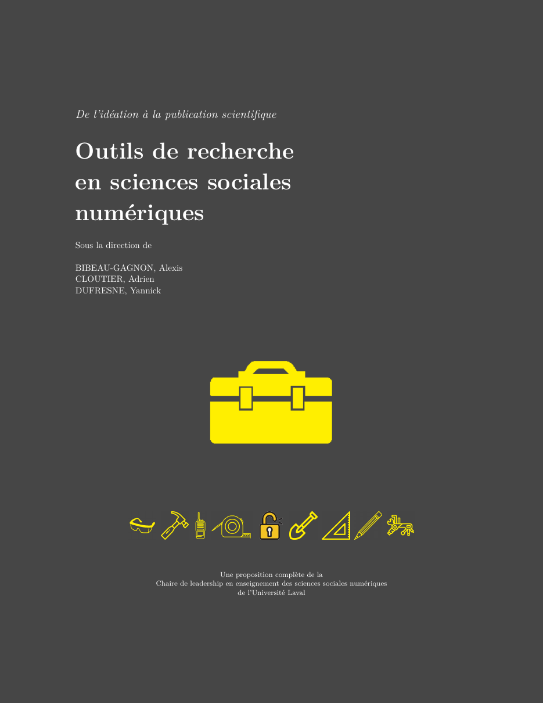

# Bienvenue {.unnumbered .web-seulement}

::: {.content-visible when-format="html"}
{.couverture-accueil fig-alt="Couverture du livre : une boîte à outils jaune sur fond gris"}

Vous êtes sur le site du livre *Outils de recherche en sciences sociales numériques*, un ouvrage collectif de la Chaire de leadership en enseignement des sciences sociales numériques (CLESSN) de l'Université Laval. Il présente les outils numériques qui servent à chaque étape d'une recherche, de la première idée jusqu'à la publication.

Vous y apprendrez à choisir vos outils et à comprendre ce que le logiciel libre change à la recherche, à programmer en $\textsf{R}$, à gérer un projet et ses données, à faire une revue de littérature rigoureuse, à collecter des données et à les visualiser, à rédiger avec `Quarto` et \LaTeX{}, puis à utiliser l'intelligence artificielle sans lui confier votre jugement. Chaque chapitre a été écrit par des personnes qui venaient elles-mêmes d'apprendre ces outils.

Ce livre a deux vies. L'édition imprimée paraîtra aux Presses de l'Université Laval en 2027. La version en ligne, que vous lisez, est gratuite et le restera. Elle continue d'évoluer, entre autres grâce aux étudiants du cours *Outils numériques en sciences sociales* (POL-6078), et chaque révision porte un numéro. Vous lisez la version . Le [journal des versions](https://github.com/clessn/livre-outils/releases) dit ce qui distingue chacune.

[Télécharger le PDF](https://github.com/clessn/livre-outils/releases/latest/download/livre-outils.pdf){.btn .bouton-livre} [Journal des versions](https://github.com/clessn/livre-outils/releases){.btn .bouton-livre-clair} [Contribuer](https://github.com/clessn/livre-outils#comment-contribuer-au-projet-du-livre-doutils){.btn .bouton-livre-clair}

Le texte est diffusé sous licence [CC BY-NC-ND 4.0](https://creativecommons.org/licenses/by-nc-nd/4.0/deed.fr) : vous pouvez le lire et le partager tel quel, en citant la source, sans usage commercial et sans modification. Les extraits de code peuvent être réutilisés et adaptés librement.

Vous avez repéré une erreur, ou vous voulez proposer un ajout ? Le lien « Modifier cette page », en haut à droite de chaque chapitre, mène au fichier correspondant sur *GitHub*, et le [guide de contribution](https://github.com/clessn/livre-outils#comment-contribuer-au-projet-du-livre-doutils) explique la marche à suivre.

Comment citer ce livre

Bibeau-Gagnon, A., Cloutier, A. et Dufresne, Y. (dir.). (2026). *Outils de recherche en sciences sociales numériques : de l'idéation à la publication scientifique* (version ). CLESSN, Université Laval. <https://clessn.github.io/livre-outils/>

La version 1.0 correspondra à l'édition imprimée. Chaque révision en ligne porte ensuite un nouveau numéro (1.1, 1.2, etc.), à indiquer dans la référence.

:::
